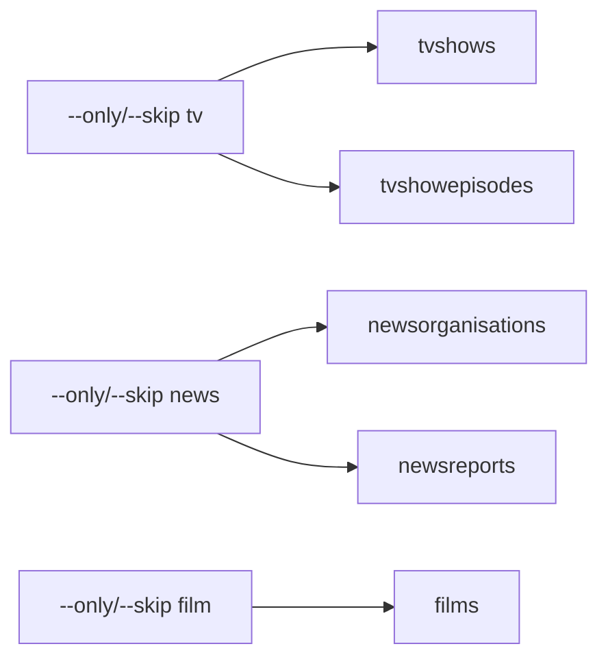
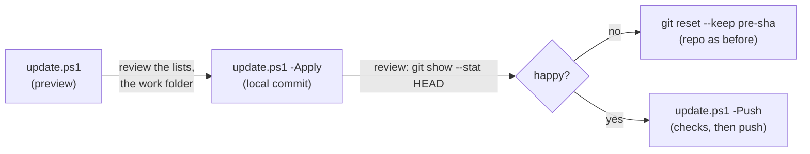

# Console apps

Local CLI tools for indexing, enrichment, discovery ops, search maintenance, and config helpers. They share one user-secrets store (`UserSecretsId` on each `.csproj`) and accept `RedditPodcastPoster_`-prefixed environment variables. See the root [README](../README.md#configuration) for secrets setup.

## How to run

```powershell
# From repo root
dotnet run --project Console-Apps/<AppName> -- [args]

# After publishing to PATH (see below)
<AppName> [args]
```

Published executable name matches the project name (e.g. `Index`, `PublishR2`, `MigrateConfig`). Most apps use [CommandLineParser](https://github.com/commandlineparser/commandline) (`Parser.Default.ParseArguments<…>`).

```powershell
.\scripts\publish-console-apps.ps1
# Opt out of concurrent publish (default is parallel after a sequential pre-build; requires pwsh 7+):
.\scripts\publish-console-apps.ps1 -Sequential
```

Defaults to `artifacts\tools\` (gitignored). Publish is **parallel by default** (sequential pre-build, then concurrent `dotnet publish`; `-ThrottleLimit` defaults to `4`). Pass `-Sequential` for one-at-a-time publish. `ThrowawayConsole` is excluded from publish. Apps publish self-contained (single-file) by default.

For `--help` on CommandLineParser apps, pass `-- --help` after `dotnet run` (or run the published exe with `--help`).

---

## Core pipeline

### Index

**Purpose:** Index episodes for one or more podcasts (local equivalent of indexer work).

**Run:** `dotnet run --project Console-Apps/Index --` · PATH: `Index`

| Option | Description |
|--------|-------------|
| `-p, --podcast-id` | Podcast GUID |
| `-n, --podcast-name` | Podcast name |
| `-u, --use-single-podcast-name-flow` | Single matching podcast name flow |
| `-r, --released-since` | Index episodes released within this many days (default `2`) |
| `-y, --skip-expensive-youtube-queries` | Skip expensive YouTube queries |
| `-d, --skip-podcast-discovery` | Skip podcast discovery (default `true`) |
| `-s, --skip-expensive-spotify-queries` | Skip expensive Spotify queries |
| `-t, --skip-youtube-url-resolving` | Skip YouTube URL resolution |
| `-f, --skip-spotify-url-resolving` | Skip Spotify URL resolution |
| `-i, --skip-spotify-indexing` | Skip Spotify indexing |
| `-x, --no-index` | Do not reindex search index |
| `-o, --force-index` | Force index-all-episodes |
| `--reindex-search` | Skip platform update; re-push all episodes for `--podcast-id` / `--podcast-name` to Azure Search from Cosmos |

### Discover

**Purpose:** Run podcast discovery locally (Listen Notes, Spotify, YouTube, Taddy), or pull unprocessed remote discovery results.

**Run:** `dotnet run --project Console-Apps/Discover --` · PATH: `Discover`

| Option | Description |
|--------|-------------|
| `-r, --number-of-hours` | Search window as timespan (`6:10:00`) or whole hours (`7`) — mutually exclusive with `-t` |
| `-t, --time-since` | Discover items released since this time — mutually exclusive with `-r` |
| `-l, --include-listen-notes` | Search Listen Notes (default `true`) |
| `-d, --include-taddy` | Search Taddy (default `true`) |
| `-s, --exclude-spotify` | Exclude Spotify (default `false`) |
| `-y, --include-youtube` | Search YouTube (default `true`) |
| `-e, --enrich-listennotes-from-spotify` | Enrich Listen Notes from Spotify (default `true`) |
| `-a, --enrich-spotify-from-apple` | Enrich Spotify from Apple (default `true`) |
| `-o, --taddy-offset` | Extra Taddy lookback for indexing delay (default `02:00:00`) |
| `-u, --use-remote` | Load/display unprocessed Cosmos discovery from cloud Discover, mark processed; skips live search |

### Poster

**Purpose:** Post recent episodes to Reddit / Twitter / Bluesky (and related publish steps).

**Run:** `dotnet run --project Console-Apps/Poster --` · PATH: `Poster`

| Option / value | Description |
|----------------|-------------|
| `[released-within-days]` | Positional; days window (default `2`) |
| `-p, --podcastid` | Podcast GUID |
| `-e, --episodeid` | Episode GUID |
| `-n, --name` | Podcast name (partial match) |
| `-y, --youtube-primary-post-service` | Prefer YouTube link when available |
| `-g, --ignore-apple-grace-period` | Ignore Apple URL grace period |
| `-t, --skip-tweet` | Skip Tweet |
| `-b, --skip-bluesky` | Skip Bluesky |
| `-w, --skip-publish` | Skip publish |
| `-r, --skip-reddit` | Skip Reddit |
| `-f, --flip-when-ignored` | Flip ignored to false and post |

### SubmitUrl

**Purpose:** Submit a URL (or file of URLs) via the same path as the API.

**Run:** `dotnet run --project Console-Apps/SubmitUrl --` · PATH: `SubmitUrl`

| Option / value | Description |
|----------------|-------------|
| `<url or file>` | Optional positional when using `--episode-id`; otherwise required URL or file of URLs |
| `-e, --episode-id` | Existing episode GUID(s) to refresh from stored `services.{streamingKey}.url` (repeatable; **requires** `-r`) |
| `-f, --submit-urls-in-file` | Treat positional as a file of URLs |
| `-p, --podcastid` | Podcast to add episode to |
| `-y, --skip-youtube-url-enrichment` | Skip YouTube URL resolving |
| `-a, --acknowledge-expensive-queries` | Allow expensive queries |
| `-m, --match-other-services` | Match other services |
| `-d, --dry-run` | Run matching, but do not write the database or the search index |
| `-i, --no-index` | Do not reindex search index |
| `-l, --is-internet-archive-playlist` | URL is an Internet Archive playlist |
| `-c, --create-podcast` | Create new podcast |
| `-r, --refresh-meta` | Overwrite title/description/release/length/image on an existing matched episode |

Refresh timing/meta for episodes that already have a streaming URL in Cosmos (e.g. submitted before extract recovered duration/release):

```powershell
SubmitUrl -r -e 07738dfc-2692-4449-b4ba-51f90acdf095
SubmitUrl -r `
  -e 8f3dd364-c400-4994-ac9f-14c081afa388 `
  -e a2a81a86-5ae7-47fc-8263-c649c99900a7
```

`--episode-id` cannot be combined with a positional url/file, `-f`, `-l`, or `-c`. Spotify/Apple/YouTube-only episodes are rejected (no streaming scrape URL).

---

## Folded apps (triage consolidations)

### PublishR2

**Purpose:** Publish static content to Cloudflare R2 and subject flairs to Reddit. Replaces former `R2Publisher` / `FlairPublisher`. Modes are CommandLineParser verbs; R2 verbs dispatch to `R2PublishRequest`/`R2PublishProcessor`, `flairs` to `FlairPublishRequest`/`FlairPublishProcessor`.

**Run:** `dotnet run --project Console-Apps/PublishR2 --` · PATH: `PublishR2`

**Verbs** (default `languages`):

| Verb | Effect |
|------|--------|
| `languages` | `R2PublishProcessor` — languages list to R2 |
| `people` | `R2PublishProcessor` — People register to R2 |
| `search-suggestions` | `R2PublishProcessor` — typeahead match index to R2 (subjects, podcasts, TV shows, news organisations, films; films carry `id`) |
| `subjects` | `R2PublishProcessor` — subjects name list to R2 |
| `homepage` | `R2PublishProcessor` — homepage JSON to R2 |
| `lookups` | languages + people + search-suggestions + subjects, then flairs (**not** homepage / feed) |
| `flairs` | `FlairPublishProcessor` — subject flairs to R2 (from Cosmos) |
| `all` | R2 languages+people+search-suggestions+homepage, then flairs |

```text
PublishR2
PublishR2 people
PublishR2 homepage
PublishR2 search-suggestions
PublishR2 subjects
PublishR2 lookups
PublishR2 flairs
PublishR2 all
```

### MigrateConfig

**Purpose:** Convert local config JSON to Azure function app-setting JSON. Replaces `SecretsToFunctionSettings` and `LaunchSettingsToAppSettings`. CommandLineParser verbs dispatch to `SecretsRequest`/`SecretsProcessor` or `LaunchSettingsRequest`/`LaunchSettingsProcessor`.

**Run:** `dotnet run --project Console-Apps/MigrateConfig --` · PATH: `MigrateConfig`

| Verb | Usage |
|------|-------|
| `secrets` | `MigrateConfig secrets <secrets-json-path>` |
| `launch-settings` | `MigrateConfig launch-settings <launch-settings-path> <profile-name>` |

```text
MigrateConfig secrets path-to-secrets.json
MigrateConfig launch-settings Cloud/Indexer/Properties/launchSettings.json Indexer
```

### RemoveEpisodes

**Purpose:** Mark matching search episodes as removed (the search is limited to `Episode` documents; the index also holds TV show episodes, films and news reports, which are left alone), restore from a prior remove log, or undo an accidental podcast removal (`restore-podcast`). `restore` folds former `UnremoveEpisodes` via `RestoreRequest`/`RestoreProcessor`; remove uses `RemoveRequest`/`Processor`.

**Run:** `dotnet run --project Console-Apps/RemoveEpisodes --` · PATH: `RemoveEpisodes`

**Verbs:**

#### `remove` (default)

| Option / value | Description |
|----------------|-------------|
| `<query>` | Required search query |
| `[throttle]` | Max episodes to remove (default `5`) |
| `-n, --not-whole-term` | Do not treat query as a quoted term |
| `-r, --non-dry-run` | Persist changes (default is dry-run) |

#### `restore`

| Option / value | Description |
|----------------|-------------|
| `<filename>` | Log file listing episodes to restore |

```text
RemoveEpisodes "some query" 10
RemoveEpisodes remove "some query" --non-dry-run
RemoveEpisodes restore removed-episodes-log.txt
```

#### `restore-podcast` (undo an accidental podcast removal)

Removing a podcast in the UI/API (`PodcastUpdateService`, `removed: true`) is a **soft delete**: it sets
`podcast.removed = true`, stamps `parentRemoved = true` on every episode, deletes every episode's Azure Search
document and deletes every episode's short-URL (Cloudflare KV) key. It does **not** change `episode.removed`.

`restore-podcast` reverses that: `podcast.removed = false`, clears `parentRemoved` on its episodes, re-indexes the
episodes that are not themselves `removed` (the indexer applies `EpisodeSearchIndexEligibility`), and re-writes
their short-URL keys (existing keys are left alone). Episodes removed before or independently of the podcast stay
removed. Dry run by default; idempotent, so re-run after a partial failure.

| Option | Description |
|---|---|
| `-i`, `--podcast-id` | Podcast id(s), comma separated |
| `-p`, `--podcast-name` | Exact podcast name(s), `\|` separated; each must match exactly one podcast (else exit 2) |
| `--skip-shortner` | Do not re-create short-URL keys |
| `-r`, `--non-dry-run` | Persist (Cosmos, search index, short URLs) |

```bash
RemoveEpisodes restore-podcast --podcast-name "Some Podcast"            # dry run: lists podcast + episode ids
RemoveEpisodes restore-podcast --podcast-id <id1>,<id2> --non-dry-run   # apply
```

**Exit codes / recovery:** `0` success · `1` Cosmos restored but a side effect (search re-index or short-URL write) failed for at least one podcast, or Ctrl+C mid-apply. Re-run the same command; it is idempotent: Cosmos saves are skipped once restored, search is re-indexed again and only missing short-URL keys are written (or `KVWriter --episode-guid <id>` for a single short URL) · `2` no/unknown/ambiguous target, nothing written.

`restore-podcast --non-dry-run` needs the same secrets as `KVWriter` (Cosmos, search, Cloudflare `shortner`/KV) via user-secrets or `RedditPodcastPoster_` env vars.

---

## Enrichment and podcast intake

### EnrichExistingEpisodesFromPodcastServices

**Purpose:** Backfill Spotify / Apple / YouTube URLs on existing episodes.

**Run:** `dotnet run --project Console-Apps/EnrichExistingEpisodesFromPodcastServices --` · PATH: `EnrichExistingEpisodesFromPodcastServices`

| Option | Description |
|--------|-------------|
| `-r, --released-since` | Enrich episodes released within this many days |
| `-y, --skip-youtube-url-enrichment` | Skip YouTube URL resolving |
| `-p, --podcast-id` | Podcast GUID |
| `-n, --podcast-name` | Podcast name |
| `-a, --acknowledge-expensive-queries` | Allow expensive queries |

### EnrichYouTubeOnlyPodcasts

**Purpose:** Enrich YouTube-only channel podcasts (playlist ingest).

**Run:** `dotnet run --project Console-Apps/EnrichYouTubeOnlyPodcasts --` · PATH: `EnrichYouTubeOnlyPodcasts`

| Option | Description |
|--------|-------------|
| `-p, --podcast-id` | Podcast GUID |
| `-i, --youtube-playlist-id` | YouTube playlist id |
| `-n, --podcast-name` | Podcast name |
| `-r, --released-since` | Only ingest items released within these days |
| `-a, --acknowledge-expensive-query` | Acknowledge expensive playlist query |
| `-s, --include-shorts` | Include Short videos |

### EnrichPodcastWithImages

**Purpose:** Enrich podcast or subject images.

**Run:** `dotnet run --project Console-Apps/EnrichPodcastWithImages --` · PATH: `EnrichPodcastWithImages`

| Option | Description |
|--------|-------------|
| `-n, --podcast` | Podcast name / partial match (selector group) |
| `-s, --subject` | Subject to enrich with images (selector group) |

### AddAudioPodcast

**Purpose:** Add a podcast from Spotify or Apple id.

**Run:** `dotnet run --project Console-Apps/AddAudioPodcast --` · PATH: `AddAudioPodcast`

| Option / value | Description |
|----------------|-------------|
| `<podcast-id>` | Required Spotify or Apple id |
| `[episode-title-regex]` | Optional title regex for occasional-cult-series |
| `-a, --apple-podcast-authority` | Use Apple for release authority |
| `-m, --spotify-market` | Spotify market to search |

### AddYouTubeChannelAsPodcast

**Purpose:** Add a YouTube channel as a podcast.

**Run:** `dotnet run --project Console-Apps/AddYouTubeChannelAsPodcast --` · PATH: `AddYouTubeChannelAsPodcast`

| Value | Description |
|-------|-------------|
| `<channel-name>` | YouTube channel name |
| `<most-recent-upload-name>` | Title of the channel’s most recent upload |

### CatalogueMigrateIdentify

**Purpose:** Dry-run corpus identify. URL scan: BBC `/news/` → News + allowlist (S-008). Podcast-level: YouTube-only publishers whose names look like news organisations (four-letter call sign, a News word, newspaper masthead such as Times/Herald, 24/7 rolling news, France 24 / Jazeera / Euronews, or ABC/NBC/CBS/FOX plus a channel number; names that say Podcast stay podcasts; curator stay-podcast names stay podcasts) with YouTube-only episodes → News + allowlist; curator-named TV programmes (canonical show name, not the channel; playables keep a services map for every platform) → TV; **two or more** stored BBC iPlayer episode URLs (no Spotify/Apple ids) → TV, even when some other episodes lack iPlayer. Film is not discovered here (use `CatalogueMigrate --kind Film --podcast-id`). Mixed Spotify plus `/news/` stays Episode and needs a curator. The TV scan reads `episode.Services` only; leftover-only iPlayer in Cosmos `urls.bbc` is not on the typed Episode and needs EpisodeServiceBackfill first. Signal-identified TV and film rows are checked against TMDB and TheTVDB only when that set is at most 50. A larger set is reported and not sent. News is not sent. A unique agreeing title is the only match. When the publisher name is not one programme, programmes come from the episodes: an iPlayer series or season slug, a repeated title (including parts), or a brand shared by two or more episodes. Each of those is checked the same way, up to 50 programmes on that publisher. A single remaining title is its own programme and is tried as a film when it is not a series. A shorter clause with several hits does not replace the full title. **`--apply` always exits 2.** Dry-run only; agent run-gate: [`.cursor/rules/catalogue-migrate-cli-dry-run.mdc`](../.cursor/rules/catalogue-migrate-cli-dry-run.mdc).

**Run:** `dotnet run --project Console-Apps/CatalogueMigrateIdentify --` · PATH: `CatalogueMigrateIdentify`

| Option | Description |
|--------|-------------|
| `--podcast-id` | Identify a single podcast GUID. Default is every podcast |
| `--apply` | Always refused (exit 2). Dry-run only; does not write Cosmos |

### CatalogueMigrate

**Purpose:** Corpus **move** from Podcast/Episode into News, Film and TV (S-007: run News, then Film, then TV). Keeps GUIDs. Dry-run by default: it logs one `Catalogue migrate plan … apply= block=` line per podcast, and apply uses the same planner. News apply needs `CatalogueNewsOrganisationAllowlist` (S-008, frozen 2 Oct 2026; 299 names after the 21 and 22 Oct 2026 curator reviews). Dry-run still discovers via Identify heuristics and logs `onAllowlist`. Auto-indexed podcasts (`IndexAllEpisodes` / `EpisodeIncludeTitleRegex`) move to News and TV with their discovery settings in the parent's `indexing` block (blank text stored as null), and the hourly indexer keeps indexing them. Only Film refuses an auto-indexed podcast. Film is a one-off (episode id, no parent) and requires `--podcast-id`. TV may be scanned from stored iPlayer series URLs on `services`, or targeted with `--podcast-id`. Leftover-only `urls.bbc` iPlayer is not visible until backfill.

`--apply` writes **only** with `--consent "I approve CatalogueMigrate --kind <Kind> production writes"`, otherwise it exits 2. Each podcast: destination upsert → verify count → same-id Search swap (`contentKind`) → delete episodes → delete podcast. Evidence goes to one JSONL per batch, with full before-snapshots. Re-running resumes. `--rollback <file>` previews a restore. Add `--apply --consent "I approve CatalogueMigrate rollback of <file name> in production"` to restore. Exit codes: 0 ok, 1 bad arguments, 2 refused, 3 a podcast failed (run stopped, source kept). Agents never pass `--apply`/`--consent`: [`.cursor/rules/catalogue-migrate-cli-dry-run.mdc`](../.cursor/rules/catalogue-migrate-cli-dry-run.mdc). Ops: [`docs/catalogue-run/gate-5.md`](../docs/catalogue-run/gate-5.md).

**Indexer window (auto-indexed podcasts only):** the Indexer's `Hourly` run starts at :03 and `HourlyCatchUp` at :08. A pass that read a podcast before the move would save it again after the move and re-create the deleted row. So `--apply` skips an auto-indexed podcast at minutes :00–:14 and :55–:59 (plan line `block=` says so; the run carries on with other podcasts). Re-run between :15 and :54 to move it. Dry-run is not affected. Separately, just before deleting the source, apply re-reads it: if the podcast was indexed (`lastIndexed` changed) or an episode arrived during the move, the source is kept and the run stops with exit 3, and a re-run moves the current rows.

**Run:** `dotnet run --project Console-Apps/CatalogueMigrate --` · PATH: `CatalogueMigrate`

| Option | Description |
|--------|-------------|
| `--kind` | `NewsReport`, `Film`, or `TvShowEpisode` (required unless `--rollback`) |
| `--podcast-id` | One podcast GUID. Required for Film. Optional for News and TV (default is identify-scan) |
| `--apply` | Write. Needs the exact `--consent` phrase, else exit 2. Auto-indexed podcasts move only at minutes :15–:54 |
| `--consent` | Human approval phrase (see above). Never default it or script it |
| `--batch-size` | Podcasts per evidence file (default 25, max 500) |
| `--limit` | Stop after this many eligible podcasts |
| `--evidence-dir` | Evidence folder (default `catalogue-migrate-evidence`) |
| `--rollback` | Evidence JSONL to restore from. Previews unless `--apply` |

### CategorisePodcastEpisodes

**Purpose:** Categorise / subject-tag podcast episodes.

**Run:** `dotnet run --project Console-Apps/CategorisePodcastEpisodes --` · PATH: `CategorisePodcastEpisodes`

| Option | Description |
|--------|-------------|
| `-p, --podcast-ids` | Comma-separated podcast GUIDs |
| `-n, --podcast-partial-match` | Podcast name / partial match |
| `-a, --recent` | Categorise recently indexed episodes |
| `-c, --Commit` | Commit changes |
| `-r, --Reset-Subject` | Reset subjects |

### EpisodeLanguageBackfill

**Purpose:** Backfill episode language fields (dry-run unless `--apply`).

**Run:** `dotnet run --project Console-Apps/EpisodeLanguageBackfill --` · PATH: `EpisodeLanguageBackfill`

| Option | Description |
|--------|-------------|
| `-a, --apply` | Apply changes; without this flag, report only |

### SeedTitleCasingRules

**Purpose:** Seed a per-language `TitleCasingRules` document (default `en`) from static lower-case words + legacy LookUps KnownTerms. Dry-run unless `--apply`. Do not run `--apply` against production without explicit approval.

**Run:** `dotnet run --project Console-Apps/SeedTitleCasingRules --` · PATH: `SeedTitleCasingRules`

| Option | Description |
|--------|-------------|
| `-a, --apply` | Write the document; without this flag, report only |
| `-l, --language` | Language code (default `en`) |

### MigrateLanguageIgnoredSubjects

**Purpose:** Two-phase migration of non-English podcast `ignoredSubjects` into per-language `TitleCasingRules.ignoredSubjects`. Dry-run by default. Phase 1 writes TitleCasingRules + an audit JSON (undo data) only when there are non-empty subjects to seed; it will **not** create an empty TitleCasingRules document when none exists. Phase 2 strips only migrated names from podcasts using that audit file. Do not run apply flags against production without explicit approval.

**Run:** `dotnet run --project Console-Apps/MigrateLanguageIgnoredSubjects --` · PATH: `MigrateLanguageIgnoredSubjects`

| Option | Description |
|--------|-------------|
| (none) | Dry-run: log planned language unions and per-podcast strips |
| `--apply-seed` | Phase 1: upsert language ignoredSubjects; write audit JSON |
| `--apply-clear` | Phase 2: clear migrated names from podcasts (requires audit file) |
| `--audit-path` | Audit/undo JSON path (default `./language-ignored-subjects-migration-audit.json`) |

### SeedSupportedLanguages

**Purpose:** Seed LookUps `SupportedLanguagesConfig`. Prefer `--from-r2` when R2 is the authority. Dry-run unless `--apply`. Skips if the document exists unless `--force`.

**Run:** `dotnet run --project Console-Apps/SeedSupportedLanguages --` · PATH: `SeedSupportedLanguages`

| Option | Description |
|--------|-------------|
| `-a, --apply` | Write the document; without this flag, report only |
| `--from-r2` | Build from current R2 `languages` object instead of `CreateDefault()` |
| `-f, --force` | Overwrite an existing LookUps document |

### FindDuplicateEpisodes

**Purpose:** Find (and optionally fix) duplicate episodes.

**Run:** `dotnet run --project Console-Apps/FindDuplicateEpisodes --` · PATH: `FindDuplicateEpisodes`

| Option | Description |
|--------|-------------|
| `-n, --not-dry-run` | Execute deletes/updates (default dry-run) |
| `--delete-no-diff` | Delete pure duplicates with no meaningful field diffs (backs up under `dedupe-episodes/`) |
| `-v, --verify-deduplication` | Verify outcomes from backup files against Cosmos |

---

## Search index

### CreateSearchIndex

**Purpose:** Create / tear down Azure AI Search index, data source, and indexer; optionally run the indexer.

**Standard layout (fits the Free tier: 3 data sources / 3 indexers / 3 indexes):** one index, `cultpodcasts`, fed by three pull indexers: episodes (`--datasource` / `--indexer`, e.g. `cultpodcasts-ds` / `cultpodcasts-indexer`), TV show episodes (`<index>-tvshowepisode-ds` / `-indexer`) and news reports (`<index>-newsreport-ds` / `-indexer`). **Films have no pull indexer**; [FilmSearchPusher](#filmsearchpusher) pushes them by Cosmos `_ts`. Any run that sets up the siblings deletes a leftover `<index>-film-ds` / `<index>-film-indexer` pair from earlier versions.

**Run:** `dotnet run --project Console-Apps/CreateSearchIndex --` · PATH: `CreateSearchIndex`

| Option | Description |
|--------|-------------|
| `-i, --index` | Index name |
| `-t, --teardown-index` | Tear down index. Always tears down and recreates the TvShowEpisode and NewsReport sibling datasources and indexers too (with or without `--all-playables`), because the deleted index held their documents; with `-r`, the siblings are run as well. Film documents are not restored by this; run `FilmSearchPusher` afterwards (it sees the empty index and pushes every film) |
| `--update-existing` | Keep index; upsert Cosmos datasource SQL from current `SearchEncodedKeys`. With `--all-playables`, also CreateOrUpdate sibling datasources and indexers. Does not copy `episodeTitle` / `podcastName` / `episodeDescription` onto a new index. **Not** a recreate |
| `--all-playables` | CreateOrUpdate the TvShowEpisode and NewsReport datasources and indexers on the same index **without a teardown** (adds them to an index that has only the episode pair), and delete a leftover Film pair. Works with a fresh run and with `--update-existing`. With `--run-indexer`, each sibling is run through the same retry monitor as `--indexer`. With `--update-existing --reset-indexer`, each sibling indexer is reset too. A teardown or `--all-playables` stops before changing anything when the service allows fewer than three data sources or indexers |
| `--reset-indexer` | With `--update-existing` + `--indexer`: reset pull high-water mark (slow on free tier; prefer `Index --reindex-search` for spot fixes) |
| `-d, --datasource` | Data-source name |
| `-x, --indexer` | Indexer name |
| `-r, --run-indexer` | Run the indexer. With `--all-playables`, also run each sibling indexer |
| `-m, --run-indexer-max-attempts` | Max rerun attempts on timeout (default `10`) |
| `-p, --run-indexer-poll-seconds` | Poll interval seconds (default `10`) |
| `-b, --not-break-on-duplicates` | Do not break on duplicates (default `true`) |
| `-w, --run-indexer-max-wait-seconds` | Max wait per run before retryable stall (default `200`) |

After adding a streaming plugin (see add-streaming-service skill §8):

```powershell
CreateSearchIndex --update-existing --index cultpodcasts --datasource cultpodcasts-ds
Index --reindex-search -n "<PodcastName>"
```

Add the scheduled TV and news indexers to the existing index (no teardown; they first run at the next :15 / :45, or add `--run-indexer` to run now):

```powershell
CreateSearchIndex --index cultpodcasts --all-playables
```

Full rebuild (for example after changing `Constants.DescriptionSize`), with the Hourly indexer paused, then put films back:

```powershell
CreateSearchIndex --index cultpodcasts --datasource cultpodcasts-ds --indexer cultpodcasts-indexer --teardown-index --run-indexer
FilmSearchPusher
```

`--transient-playables` (one-at-a-time TV / Film / News loads) was removed: TV and news are now permanent indexers, and a transient Film indexer would need a fourth data source on the Free tier.

### FilmSearchPusher

**Purpose:** Push film search documents from the Cosmos `Films` container into the search index, in place of a Film pull indexer (the Free tier's three data sources are used by episodes, TV and news). Run locally, once a day.

**Run:** `dotnet run --project Console-Apps/FilmSearchPusher --` · PATH: `FilmSearchPusher`

| Option | Description |
|--------|-------------|
| `--full` | Push every film and delete `contentKind eq 'Film'` documents whose film no longer exists in Cosmos (hard deletes leave no `_ts`), ignoring the watermark |
| `-n, --dry-run` | Read and plan only: logs what would be pushed and deleted. No search writes, no watermark save |
| `-b, --batch-size` | Documents per index request, 1–1000 (default `500`) |

How it works:

- **Incremental (default):** reads films with `_ts >=` the saved watermark (the boundary second is re-pushed so a film saved later in that second is not missed), merge-or-uploads each document built by `CataloguePlayableSearchDocument.For(Film)` (the curator edit's document, description cut to `Constants.DescriptionSize`), and deletes the document of any film marked removed.
- **Becomes a full push** when `--full` is given, when no watermark has been saved, or when the index holds no film documents (straight after a teardown).
- **Watermark:** the `FilmSearchPushWatermark` singleton in Cosmos `LookUps` (`highWaterMark` = highest film `_ts` pushed, plus `updatedUtc` and last-run counts). It advances only after every push and delete succeeded, so a failed run is retried in full. Exit code `1` on any failure.
- Curator film edits and Move to film still push their document straight away; this run catches anything else (CatalogueMigrate film applies, rebuilds) within a day.

```powershell
FilmSearchPusher --dry-run   # what would change
FilmSearchPusher             # daily incremental push
FilmSearchPusher --full      # push all films and remove orphaned film documents
```

### DeleteSearchDocument

**Purpose:** Delete a document (or all episodes for a podcast) from the search index.

**Run:** `dotnet run --project Console-Apps/DeleteSearchDocument --` · PATH: `DeleteSearchDocument`

| Option / value | Description |
|----------------|-------------|
| `<document-id>` | Required GUID (episode document, or podcast id with `-p`) |
| `-p, --podcast` | Delete all episodes for the given podcast id |

### AddSubjectToSearchMatches

**Purpose:** Add a subject to episodes matching a search query (the search is limited to `Episode` documents; the index also holds TV show episodes, films and news reports, which are left alone).

**Run:** `dotnet run --project Console-Apps/AddSubjectToSearchMatches --` · PATH: `AddSubjectToSearchMatches`

| Option / value | Description |
|----------------|-------------|
| `<query>` | Required search query |
| `[throttle]` | Max episodes to update (default `5`) |
| `-s, --add-subject-when-not-subject-match` | Add subject for any search hit (bypass subject match) |
| `-n, --not-whole-term` | Do not treat query as a quoted term |
| `-d, --dry-run` | Do not persist |

---

## Discovery scoring and training

### DiscoveryScoreBackfill

**Purpose:** Score discovery documents (all unprocessed, or specific ids).

**Run:** `dotnet run --project Console-Apps/DiscoveryScoreBackfill --` · PATH: `DiscoveryScoreBackfill`

| Option | Description |
|--------|-------------|
| `-a, --all-unprocessed` | Score all unprocessed discovery documents |
| `-d, --document-ids` | Comma-separated discovery document GUIDs |
| `--dry-run` | Score/analyze without saving to Cosmos |
| `--evidence-path` | Path for markdown evidence report |

### DiscoveryTrainingExport

**Purpose:** Export discovery training CSV from a CosmosDbDownloader export (or analyze existing CSVs).

**Run:** `dotnet run --project Console-Apps/DiscoveryTrainingExport --` · PATH: `DiscoveryTrainingExport`

| Option | Description |
|--------|-------------|
| `-e, --export-path` | Root folder of a CosmosDbDownloader export |
| `-o, --output-path` | CSV output folder (default `<export-path>/analysis`) |
| `-a, --analyze-only` | Skip export; analyze existing CSVs |
| `--analysis-path` | Folder with `discovery-results.csv` (analyze-only override) |

### DiscoveryTrainingTrain

**Purpose:** Train discovery scoring model from `discovery-results.csv`.

**Run:** `dotnet run --project Console-Apps/DiscoveryTrainingTrain --` · PATH: `DiscoveryTrainingTrain`

| Option | Description |
|--------|-------------|
| `-c, --csv-path` | Path to `discovery-results.csv` (required) |
| `-o, --output-path` | Model bundle output directory (required) |
| `-m, --onnx-model-directory` | MiniLM ONNX + vocab dir (default `<output-path>/onnx`) |
| `-s, --show-rates-path` | Optional `show-accept-rates.csv` |
| `--max-rows` | Limit rows for a quick training run |
| `--threshold` | Auto-hide probability threshold in manifest (default `0.05`) |
| `--skip-download` | Skip ONNX download if files exist |

---

## Cosmos and public data

### CosmosDbDownloader

**Purpose:** Download Cosmos containers (podcasts, episodes, subjects, discovery, push subscriptions, LookUps, title-casing rules, people, films, TV shows/episodes, news organisations/reports) to local JSON files.

LookUps are written under `lookups/` via typed getters (elimination terms, discovery schedule, supported languages, homepage cache, YouTube quota/state, plus legacy KnownTerms if still present). Title-casing known terms live in the TitleCasingRules container (`titlecasing/`), not LookUps.

**Parallelism:** Selected containers download concurrently (`Task.WhenAll`). Large containers (podcasts/episodes) use a single Cosmos feed reader plus bounded parallel disk writers (4–16, based on CPU). Progress uses Spectre.Console multi-task bars (`ProgressTask.Increment` is safe across writers).

**Run:** `dotnet run --project Console-Apps/CosmosDbDownloader --` · PATH: `CosmosDbDownloader`

| Option | Description |
|--------|-------------|
| `--only a,b,…` | Download only these containers (default: all) |
| `--skip a,b,…` | Skip these containers (cannot combine with `--only`) |
| `-o, --overwrite` | Replace existing local JSON files (default: fail if a file already exists) |

Container names: `podcasts`, `episodes`, `lookups`, `titlecasing`, `subjects`, `discovery`, `pushsubscriptions`, `people`, `films`, `tvshows`, `tvshowepisodes`, `newsorganisations`, `newsreports`. Canonical names and most aliases (`title-casing`, `push`, `person`, `film`, `tvshow`, `tv-show`, `newsorganisation`, `newsreport`, …) select **one** container. Family aliases expand to parent plus playable: `tv` → `tvshows` + `tvshowepisodes`; `news` → `newsorganisations` + `newsreports`. Film has no parent, so `film` is films only. `--only` / `--skip` apply that resolved set. Activities are not downloaded. Catalogue folders: `film/`, `tvshow/`, `tvshowepisode/`, `newsorganisation/`, `newsreport/`.




Examples:

```text
CosmosDbDownloader
CosmosDbDownloader --only lookups,titlecasing
CosmosDbDownloader --only lookups,titlecasing --overwrite
CosmosDbDownloader --skip episodes,discovery,pushsubscriptions
```

### CosmosDbUploader

**Purpose:** Upload local JSON entity files back into Cosmos. No CLI flags — runs the full upload. Expects `lookups/` from a current downloader run (falls back to legacy singleton files if that folder is missing).

**Run:** `dotnet run --project Console-Apps/CosmosDbUploader` · PATH: `CosmosDbUploader`

### CultPodcasts.DatabasePublisher

**Purpose:** Publish the public JSON database from Cosmos into the current directory, one file per live item:

| Kind | File key | Content |
|------|----------|---------|
| Podcast | `{slug}` | podcast with its episodes |
| TV show | `tvshow-{slug}` | show with its episodes |
| News organisation | `news-{slug}` | organisation with its reports |
| Film | `film-{slug}` | the film itself (no children) |

Removed items and removed episodes or reports are not published. A show, organisation or podcast with no episodes or reports at all gets no file; one whose episodes or reports are all flagged removed still gets a file with an empty list, exactly as podcasts always have (the check counts rows, removed or not). The podcast file shape and bytes are unchanged (pinned by a golden rule test). Children of TV shows and news organisations are listed newest first with ties broken by id, so the files do not change between runs; podcast episodes keep their existing ordering.

The TV show, news and film files differ from the podcast file on purpose:

- `release` is always a string that keeps the catalogue precision: `2019`, `2019-05-01` or `2019-05-01T12:00:00Z`. Podcast episodes always carry a full date-time.
- `urls` is a map of catalogue service key to url for every service the item has (`spotify`, `apple`, `youtube`, and the streaming keys such as `bbcIplayer`, `bbcSounds`, `internetArchive`, `netflix`). Podcast episodes keep their fixed object (`spotify`, `apple`, `youtube`, `internetArchive`, `bbc`), where BBC iPlayer and BBC Sounds share the single `bbc` key.

**A release keeps the text of the previous publish when it is the same instant.** A date-time is written with a trailing `Z` when its value is UTC and without one when it is not, and the same release has been stored both ways over the life of the catalogue, so formatting every release afresh would rewrite thousands of unchanged lines. A file therefore only changes for a real change:

- **Kept:** an episode (or report) that is in the previous file with the same id, where the previous `release` and the new one are both full date-times (`yyyy-MM-ddTHH:mm:ss`, optionally with up to seven fractional digits and a `Z` or `+hh:mm` offset) for the same UTC instant, keeps the previous text exactly: `2026-08-17T00:00:00` stays `2026-08-17T00:00:00`, and `2026-08-17T10:30:15Z` stays as it is. Instants are compared as UTC, with text that has no zone read as UTC, so an offset or a different number of fractional digits is the same instant too.
- **Not kept:** a different instant, an episode that is new to the file, or a previous text that is not a full date-time in that shape (a year, a bare date such as `2019-05-01`, words, an impossible date, a number, null) is written as it would be without a baseline: for a podcast episode the instant with a trailing `Z`, for a TV show episode or news report the catalogue's own precision. A year or a bare date is never held against a date-time, so a catalogue release that gains a time of day is published with it.
- **The baseline:** the previous publish's file with the same file key and the same id or, for a file that is moved first (a rename, or a podcast that became a TV show or news organisation), the file it is moved from. A file with a different id is not used, and a new file has no baseline. This applies to podcast episodes, TV show episodes and news reports; a film is a single item with no previous text of its own.
- **Reading:** the texts are read once, together with the baseline files at the start of the run, and are only ever read. A file that cannot be read at all (locked, no access) stops the run before anything is planned or changed, like any unreadable file in the folder (exit code 2); a file that is not JSON of the expected shape has no id, so the plan treats it as an unexplained removal (see the list below) that must be accepted knowingly.

**The output folder is the baseline.** Run the publisher in the folder that holds the previous publish (the PublicDatabase checkout) and do not clear it first. Before touching any file it reads every top-level `*.json` there, reads the catalogue once, checks every file key and id, and plans the whole run:

- a file whose item is still published under the same key and id is replaced in place;
- a file whose item moved to another file name is **moved** to that name first (`File.Move`, no git needed) and then overwritten with the new content: a renamed podcast, a podcast transferred to a TV show (`tvshow-{slug}`) or news organisation (`news-{slug}`) with the same id, and a podcast whose only episode became a film (`film-{slug}`, found because the film takes the episode's id, which is listed in the old file). Each move is logged and listed in the migration manifest (below). A podcast whose episodes all became several films has its file deleted and the films created, with no move; a move never overwrites an existing file. A podcast file where only some of its episodes became films is not treated as migrated: the others are not accounted for, so it is unexplained (the message says how many) until accepted;
- a file whose item is flagged removed is deleted;
- any other file that would stop being published is **unexplained**: the item is gone from Cosmos (including a podcast file where only some episodes became films), still exists but has nothing to publish, has been replaced by another item under the same key (so two items swapping keys is unexplained too), or the file has no readable id. If there is any, nothing is written, moved or deleted, the list is printed and the run exits with 1. File keys are compared exactly, so a key that differs from the existing file only by case is a delete and a create;
- new files are created; only planned files are ever created, replaced, moved or deleted.

**Nothing is touched until all content is built.** After planning, every new file is first built from Cosmos into a staged `{key}.json.tmp` next to its target (same folder, so the final step is a rename), and the folder is checked to be unchanged since it was read (the same set of `*.json` files, each with the same length and last-write time; contents are not hashed). If `--migrations-out` was given, the manifest is written at this point too. Only then are the deletions and moves applied and each staged file swapped in. A Cosmos failure, an unwritable manifest path, or a folder that changed meanwhile, therefore leaves the folder exactly as it was (staged files are removed again; exit 3, or 2 for the changed folder). If the process dies while applying, the folder may be partly updated and the unswapped `*.json.tmp` files remain: the next run refuses (exit 2) and names them; check `git status`, then run again with `--discard-staging`, and the plan is made again from whatever the folder now holds. Repeat only the `--accept-removal` values whose files still exist: a file the first run already deleted is gone, so repeating its value blocks the run as an unused acceptance. Keep the first run's migration manifest (use a different `--migrations-out` path for the re-run): the re-run only knows what is left to do and writes the manifest of that. One window: a podcast whose only episode became a film is moved to the film's name before the film is swapped in, and that file still carries the podcast's id until then; if a crash lands exactly there, the next run reports it as replaced by another item, and `--accept-removal film-{slug}` resolves it.

Git only sees the final tree and pairs an old and a new file by content similarity, however the new file got its name, so a move and a delete plus create are paired identically and there is no guarantee either way: a large change in content is recorded as a delete and an add. The move, the log and the manifest exist so the publisher can state exactly which file became which.

**Migration manifest.** With `--migrations-out <path>` a successful publish writes `{ "version": 1, "migrations": [ { "id", "newId", "oldFile", "newFile", "kind", "reason" } ] }` there (indented, sorted by old then new file; an empty list when there were none; written after the content is staged and before the folder is changed, so it states what the plan intended even if applying then fails, and an unwritable path fails the run with the folder untouched; never when the plan is blocked). `oldFile` and `newFile` are file names relative to the output folder, `id` is the old file's item id, `newId` the new file's (a film has its episode's id), `kind` is the new kind (`podcast`, `tvShow`, `newsOrganisation`, `film`) and `reason` is `renamed` or `migrated`. It lists every renamed or migrated file the plan acted on, including one deleted rather than moved because its target already existed, and one entry per film for a podcast that became several. A tool can check each entry against `git diff --cached -M --name-status` after `git add -A` to report whether git saw a rename. The path must be outside the output folder (otherwise the run fails with exit 2 before changing anything), so the manifest can never be committed with the data; with no `--migrations-out` none is written. The check resolves symbolic links, junctions, short names and case for the parts of the path that exist; it does not see a link created after the check or a hard link to a file.

| Option | Description |
|--------|-------------|
| `--initial` | There is no previous publish: the output folder holds no published files. Required for a first publish; an empty folder without it is refused (exit 2), and `--initial` with files present is refused too. |
| `--accept-removal <file key or id>` | Repeatable. Accept one unexplained removal after checking it: that file is deleted and the run continues. An accepted value that matches no unexplained removal blocks the run, so a stale flag is not ignored. |
| `--discard-staging` | Delete the `*.json.tmp` files an interrupted run left in the output folder before running. Without it, their presence refuses the run (exit 2). |
| `--migrations-out <path>` | Write the migration manifest (above) to this path before the folder is changed. Must be outside the output folder. |
| `--use-v2` | Ignored (legacy). |

Exit codes: `0` published; `1` the data cannot be published consistently (a file-key or id problem, or unexplained removals, in which case nothing was changed); `2` the arguments or the output folder are unusable (a missing folder, one wrongly empty or populated, a `--migrations-out` path inside it), or staged files from an interrupted run are present (nothing was changed); `3` an unexpected failure (for example Cosmos or the disk): the folder is unchanged unless the message says it may be partly updated, in which case run `git status` and then `--discard-staging`.

The check works on whole files by key and id (and on episode ids to recognise a podcast that became a film). It does not compare file contents, so an episode that disappears from inside a file that is still published is not detected. Two live films with the same title would share `film-{slug}.json`; the run fails naming both films, and one must be given a different stored `fileKey` in Cosmos (the policy for choosing one is tracked in cultpodcasts/RedditPodcastPoster#1041).

**Run:** `dotnet run --project Console-Apps/CultPodcasts.DatabasePublisher` · PATH: `CultPodcasts.DatabasePublisher`

#### `update.ps1`: publishing into the PublicDatabase repo

`CultPodcasts.DatabasePublisher/PublicDatabaseScripts/update.ps1` is the script that publishes the public database into the PublicDatabase repo (it replaced the old script that deleted every `*.json` first; the publisher now needs those files as its baseline). **The copy in this repo is the source of truth.** The script works on the folder it sits in, so it runs from a copy in the root of the PublicDatabase checkout:

```powershell
Copy-Item <RedditPodcastPoster>\Console-Apps\CultPodcasts.DatabasePublisher\PublicDatabaseScripts\update.ps1 <PublicDatabase>\update.ps1
```

**The PublicDatabase copy must be refreshed by copying again after every change to the script here.** On every run the script compares its own content (line endings ignored, since the repo stores LF and a Windows checkout has CRLF) with the script at the checked-out `HEAD` of the `-SourceRepo` clone and warns when they differ, so a stale copy is spotted without relying on anyone bumping a number; pull the clone first to compare with the latest `main`. The check only warns, and says so when it cannot compare (no clone, or no script at its `HEAD`). The `$ScriptVersion` line is a human-readable label printed at the start (`update.ps1 version X`); bump it with each change. Edit the script here, never in PublicDatabase.

The script refuses to run from anywhere but the root of a git checkout that is not inside the `-SourceRepo` clone, so running the source copy here, or a copy in a sub-folder, stops at once with a message pointing back to this section.

Before running it, publish the exe from a RedditPodcastPoster checkout that has the change you want: `pwsh scripts/publish-console-apps.ps1 -App CultPodcasts.DatabasePublisher` (to `artifacts\tools`). The script finds the exe and the clone through `-SourceRepo` and refuses an exe built before `--migrations-out` existed, by looking its commit up in that clone; `-PublisherExe` points it at an exe somewhere else, such as a temporary publish of a branch. The default `-SourceRepo` is a per-machine convention, not a requirement: with the checkout at `<repos>\PublicDatabase` it is `<repos>\cultpodcasts\RedditPodcastPoster` (a `cultpodcasts` folder beside the PublicDatabase checkout that holds the clone). Pass `-SourceRepo` when the clone is elsewhere. Relative `-SourceRepo`, `-WorkFolder` and `-PublisherExe` values are resolved against PowerShell's current location.

The script is written for and tested with PowerShell (Windows PowerShell 5.1 and pwsh 7) on Windows. It builds paths with `Join-Path` and compares file keys case-sensitively, but pwsh on Linux or macOS is untested.

```powershell
.\update.ps1                                  # preview (the default): the repo is not touched
.\update.ps1 -AcceptRemoval <id|file key>,... # after checking each unexplained removal the preview listed
.\update.ps1 -Apply                           # copy the result in, stage, check renames, commit LOCALLY (never pushes)
.\update.ps1 -Apply -CommitDate 2026-10-19    # commit message 'New episodes 19 October 2026' (default: today)
#   ... review the commit (git show --stat HEAD); undo it with git reset --keep <sha printed by -Apply> ...
.\update.ps1 -Push                            # push the reviewed commit(s), after the upstream checks below
```

A commit and a push never happen in the same run: a local commit can be undone, a push cannot. `-Apply` and `-Push` together are refused. `-SkipPush` (version 1.1) is gone, because `-Apply` no longer pushes; passing it fails at parameter binding rather than quietly meaning something else.



- **Preview** copies the repo's top-level `*.json` into a sibling working folder (`-WorkFolder`, default `..\PublicDatabase-publish`), runs the publisher there (it is the baseline, so nothing is deleted first) and prints what would be created, replaced, moved and deleted. It writes `PublicDatabase-publish.report.txt` (added, removed and changed files) and `PublicDatabase-publish.migrations.json` next to the working folder and, for each migration in the manifest (renamed, or moved to a TV show, news organisation or film), says whether git would see a rename or a delete plus an add. The repo's files, index and objects are not touched. A refused publish (exit 1) stops with the reason and a ready-to-paste `-AcceptRemoval` line per unexplained removal. If the checkout has modified or untracked top-level `*.json`, the preview warns: the added/removed/changed lists compare with the working-tree files but the git rename view compares with `HEAD`, so they can disagree (and `-Apply` would refuse).
- **`-Apply`** first checks, before anything is copied: nothing staged and no modified or untracked top-level `*.json`, and a checked-out branch (not a detached `HEAD`). It records `HEAD` as the undo point. It then publishes afresh (so it can differ from the preview if the data changed), copies the result into the repo, stages only the top-level `*.json`, re-checks the renames against the manifest, and commits `New episodes <date>` (the date is `-CommitDate`, default today) **locally; it never pushes and does not contact the remote**. After the commit it shows `git show --stat HEAD` and the short stat against the undo point, and prints the review commands, the undo command (`git reset --keep <pre-sha>`, safe because nothing else was staged and the JSON was clean, and `--keep` refuses rather than discard unrelated edits such as `update.ps1` itself) and the next step (`.\update.ps1 -Push`). If the copy, the staging or the commit fails part way (an `index.lock`, no `user.name`/`user.email`, a hook), it prints how to put the repo back before rethrowing: `git reset --keep <pre-sha>` if a commit was made, otherwise `git restore --source=HEAD --staged --worktree -- ':(glob)*.json'` and `git clean -f -- ':(glob)*.json'`.
- **`-Push`** is a separate run after the commit has been reviewed. It does not run the publisher or need the exe. It refuses if anything is staged or a top-level `*.json` is modified or untracked, if `HEAD` is detached, or if the branch has no upstream on a remote. It then runs `git fetch` and refuses if the branch is behind its upstream (printing how to undo the local publish, pull and apply again) or has nothing to push. It shows `git log --oneline @{u}..HEAD` and `git diff --stat -M @{u}..HEAD`, and warns about any commit to be pushed that is a merge, is not a `New episodes ...` commit, or changes anything other than top-level `*.json`; with any such warning it asks `Push anyway? [y/N]` and refuses unless the answer is yes. Finally it pushes explicitly with `git push <remote> HEAD:<upstream branch>` (never a bare `git push`).
- It needs `git` and the publisher's own Cosmos access (the publisher reads its secrets as it always has).

## Ops utilities

### KVWriter

**Purpose:** Create or read shortener (KV) records for episodes.

**Run:** `dotnet run --project Console-Apps/KVWriter --` · PATH: `KVWriter`

| Option | Description |
|--------|-------------|
| `-i, --items` / `-s, --skip` | Batch: take / skip counts |
| `-e, --episode-guid` / `-d, --dry-run` | Single episode shortener create |
| `-r, --read` | Read by short-guid |

### ThrowawayConsole

**Purpose:** Ad-hoc scratch tool (currently probes a YouTube video from an Internet Archive-style URL argument). **Excluded from** `publish-console-apps.ps1`.

**Run:** `dotnet run --project Console-Apps/ThrowawayConsole -- <internet-archive-url>`

---

## Related

- Root README — [Useful console apps](../README.md#useful-console-apps) and [Published CLI tools](../README.md#published-cli-tools-path)
- Publish script: [`scripts/publish-console-apps.ps1`](../scripts/publish-console-apps.ps1)
- Optional diagnostic timing: set `TimedHomepagePublisher.EnableDiagnosticTiming` / `TimedEpisodeUpdateService.EnableDiagnosticTiming` so IoC wraps those services and logs `HomepagePublishTiming` / `EpisodeUpdateTiming`.
