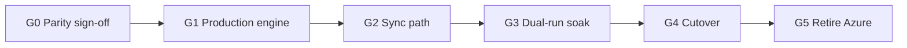

# Search platform — switchover plan (gated)

Authoritative ticket catalogue also lives in
[../search-platform-epic.md](../search-platform-epic.md) §8. This file is the
**operational** plan agents follow when working tickets.

Epic issue: **SP-E** → https://github.com/cultpodcasts/RedditPodcastPoster/issues/1312  
Board: https://github.com/users/cultpodcasts/projects/1  

## Gates and exit criteria

| Gate | Intent | Exit when |
|------|--------|-----------|
| **G0** | Freeze parity baseline | Harness green; week log-replay 0 in-corpus misses; shape nits listed; divergences documented |
| **G1** | Production-ready search Worker | Dedicated D1; Sessions API; service binding; admin upsert/delete; secrets parity planned; shape nits fixed; proxy error-forwarding shipped |
| **G2** | Backend drips into D1 | Dual-write Azure+D1; weekly reconcile + shadow rebuild; drift threshold; `read_replication=auto` |
| **G3** | Prove live equivalence | Shadow sampler drift-free for soak window; latency/overload SLOs held |
| **G4** | Swap `apihost` | Preview soak → production flip; rollback = flip back |
| **G5** | Decommission + unlock enhancements | Azure index + hourly indexer retired; DescriptionSize raised; guests indexed; §6A unblocked |

## Ticket map (stable IDs)

### G0 — Parity sign-off

| ID | Work | Repo |
|----|------|------|
| SP-G0 | Gate checklist | RPP |
| SP-0.1 | Record parity baseline in docs | RPP |
| SP-0.2 | Response shape nits (release ms, podcastName, context) | Api |
| SP-0.3 | Decision: full-description vs strict-content soak | RPP |

### G1 — Production engine

| ID | Work | Repo | Notes |
|----|------|------|-------|
| SP-G1 | Gate checklist | RPP | |
| SP-1.1 | Dedicated search D1 + bindings | Api | secrets parity |
| SP-1.2 | Sessions API + `read_replication=auto` | Api | after 1.1 |
| SP-1.3 | Service binding api → search Worker | Api | Bot Fight Mode |
| SP-1.4 | Admin upsert/delete route | Api | |
| SP-1.5 | Forward upstream errors from `/search` proxy | Api | [known-bugs.md](./known-bugs.md) |
| SP-1.6 | Drop empty-body-400 legacyName latch | website | after 1.5 |
| SP-1.7 | Secondary sort by `id` | Api | |
| SP-1.8 | bm25 per-column weights | Api | may slip past G4 |

### G2 — Sync

| ID | Work | Repo |
|----|------|------|
| SP-G2 | Gate checklist | RPP |
| SP-2.1 | `SearchIndexerService` dual-write | RPP |
| SP-2.2 | Weekly reconcile + drift threshold | RPP |
| SP-2.3 | Shadow rebuild + rename swap | Api |
| SP-2.4 | Optional Queues consumer | Api |

### G3 — Soak

| ID | Work | Repo |
|----|------|------|
| SP-G3 | Gate checklist | RPP |
| SP-3.1 | Shadow-query sampler in api Worker | Api |
| SP-3.2 | Soak window + SLO dashboard | RPP |
| SP-3.3 | Load-test on replicas | Api |

### G4 — Cutover

| ID | Work | Repo |
|----|------|------|
| SP-G4 | Gate checklist | RPP |
| SP-4.1 | Preview apihost flip | Api |
| SP-4.2 | Production apihost flip + rollback runbook | Api |
| SP-4.3 | Stale-client `podcastName` handling | Api |

### G5 — Retire + enhancements

| ID | Work | Repo |
|----|------|------|
| SP-G5 | Gate checklist | RPP |
| SP-5.1 | Retire Azure index + hourly indexer | RPP |
| SP-5.2 | Raise DescriptionSize; index guests | RPP |
| SP-5.3 | Autosuggest enrichment from D1 | Api |
| SP-5.4 | Spell-correct / did-you-mean | Api |
| SP-5.5 | Recency blend + proximity boost | Api |

Full URL table: epic §8.5. Issued 2026-11-08.

## Board rules

1. Every `SP-*` issue must be a **visible Todo card** on the features board (sidebar link
   alone is insufficient). Add with:
   `pwsh ./scripts/add-issue-to-features-board.ps1 -Owner cultpodcasts -ProjectNumber 1 -IssueUrl <url>`
2. New tickets under this epic: mint next `SP-{gate}.{n}`, label `epic:search-platform`,
   board-add, link from SP-E / SP-G* checklists.
3. Cloud Agent App tokens can **open** issues but often **cannot** write Projects/labels —
   use a `cultpodcasts` PAT (`repo` + `project`) for board/label ops
   (`/opt/cursor/artifacts/sp-label-and-board.ps1` pattern).

## Cutover sketch (G4)

1. Dual-write + reconcile green (G2); soak green (G3).
2. Preview: point `api-preview` `apihost` at search Worker via **service binding**.
3. Soak preview; compare shadow sampler.
4. Production flip (explicit user deploy approval required).
5. Rollback: restore previous `apihost` (Azure URL). Keep Azure dual-write until G5.
