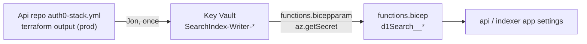
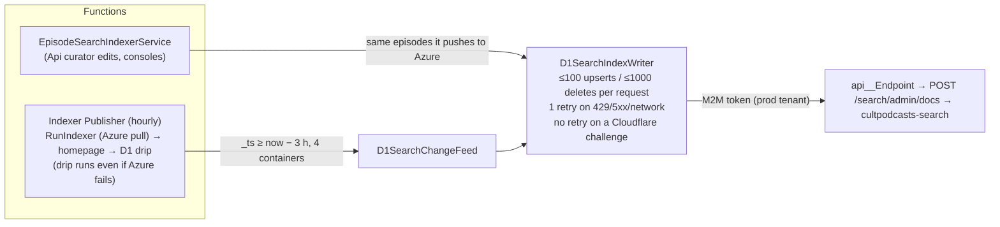
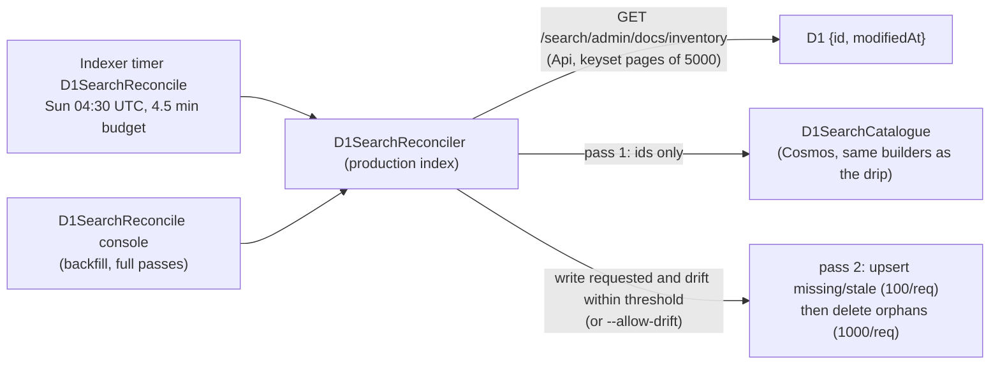
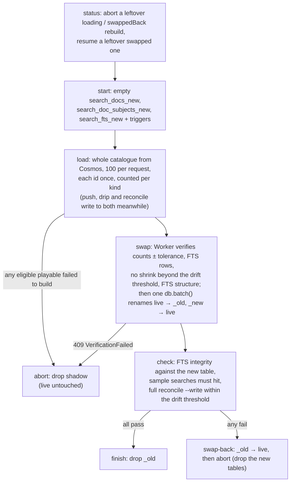

# Search sync, weekly reset, and read replication

## Today (Azure)

| Path | Mechanism | Fate |
|------|-----------|------|
| Hourly pull | Azure Search indexer ← Cosmos `_ts` watermark | **Retire** (Azure-only) |
| Push on mutation | `SearchIndexerService.MergeOrUpload` / `Delete` | **Keep** — retarget at D1 |

## Target: drip + weekly safety net

### Drip (in-week amends)

Existing push call-sites POST batches to an authenticated search Worker admin route:

```json
{ "upserts": [ /* CompactSearchRecord-shaped docs */ ], "deletes": [ "id", "…" ] }
```

Worker applies one `db.batch()`:

- `INSERT … ON CONFLICT DO UPDATE` / `DELETE`
- FTS external-content triggers keep the index in step
- `modified_at` guard ignores stale replays (reorder/retry safe)
- Upserted row visible to the next query — no downtime

Transport: shared-secret header (like today’s `api-key`) or Auth0 M2M. Prefer landing on
the api Worker then **service binding** to the search Worker (avoids Bot Fight Mode on
public hostnames). The Functions are production only, so they hold production secrets only.

Expected volume: tens of mutations/hour — far below any batching threshold.

### Writer credentials (SP-2.5, #1460)

The Functions call the api Worker's `POST /search/admin/docs` with an Auth0 **M2M** token for the
dedicated `search-index-writer` app in the **prod** Auth0 tenant (Api#284/#285, Terraform in the Api
repo). There are only production Functions, so they know only the **production** D1 index; the
staging tenant's writer app and the preview D1 index are never used by the Functions (Jon, 17 Nov 2026).
The credentials reach bicep from Key Vault with `az.getSecret`, like `Auth0-ClientId`/`Auth0-ClientSecret`:



| Endpoint | Auth0 tenant | Key Vault secrets | Switch (`functions.bicepparam`) |
|----------|--------------|-------------------|-------------------------------|
| `api__Endpoint` (Key Vault `Api-Endpoint`, the Bot Fight bypass host) | prod (`auth.cultpodcasts.com`) | `SearchIndex-Writer-ClientId`, `SearchIndex-Writer-ClientSecret` | `d1SearchProductionEnabled` (default **false** until Jon's OK) |

- **One-time setup (Jon; done 17 Nov 2026):** the two Key Vault secrets in the management
  vault (`AZURE_KEYVAULT_NAME`), `SearchIndex-Writer-ClientId` and `SearchIndex-Writer-ClientSecret`,
  hold the prod `search-index-writer` client's id and secret from the Api repo's Auth0 Terraform output
  (workspace `cultpodcasts-auth0`, outputs `client_id` and `client_secret`). Like every other
  `az.getSecret`, provision fails if they are missing.
- **Rotation / rebuilt client:** update the two secrets, then re-run *Provision and Deploy* with
  `run_provision`. App settings only change when provision runs.
- With the switch off (the default), the settings are present but nothing is sent; Azure indexing is
  unaffected either way.

### As built (SP-2.1, #1321)

Code: `Class-Libraries/RedditPodcastPoster.EntitySearchIndexer/D1Search/`. Azure is untouched; D1 is written
**next to** it, never instead of it.



| Path | What | Why |
|------|------|-----|
| **Drip** (`D1SearchChangeFeed`, Publisher) | Every episode, TV episode, news report and film whose Cosmos `_ts` is in the last `d1Search:DripLookbackMinutes` (180): eligible → upsert, excluded → delete | The Azure **pull** indexers (and the FilmSearchPusher) are how most documents reach Azure; the Indexer function's new episodes never pass a push site. Stateless (no watermark, no LookUps write); the overlap is a free retry thanks to `modifiedAt`. |
| **Push mirror** (`EpisodeSearchIndexerService`) | The same episodes the Api/console push sends to Azure, upsert or delete, whatever Azure answered | Curator edits and removals show up in D1 at once, as in Azure. |
| **Not covered** | Cosmos **hard deletes** (no `_ts` left) | SP-2.2 reconcile (#1322) removes orphans. |

- **Same corpus as Azure:** documents come from the Azure push builders (`ToEpisodeSearchRecord`,
  `CataloguePlayableSearchDocument.For`), so image/service/identity rules are shared. Only the full
  description, `guests` and `modifiedAt` (= `_ts` × 1000) are added (SP-0.3). Eligibility
  (`D1SearchEligibility`) is Azure's: removed episode or podcast, denormalised `parentRemoved`, removed film.
- **Never breaks Azure:** the writer catches every D1, network and Auth0 failure, logs it at Error with the
  status and the Worker's message, and returns it. The Publisher guards the drip again. Azure results are
  returned unchanged.
- **One index:** the Functions write the **production** D1 index only (there are no preview Functions; Jon,
  17 Nov 2026). Settings: `d1Search:Enabled`, `d1Search:ClientId`, `d1Search:ClientSecret`, plus the existing `api:Endpoint`, `auth0client:Domain` and `auth0client:Audience`.
- **Switch:** `d1Search:Enabled` (bicep `d1SearchProductionEnabled`, **false** until Jon's OK). Enabled without
  endpoint or credentials is skipped with one warning. Other console apps have no D1 writer settings, so they never
  write D1. The one exception is `D1SearchReconcile` (SP-2.2): it reuses `api:Endpoint` and `auth0client:Domain` /
  `Audience`, reads `d1Search:ClientId` and `d1Search:ClientSecret` from local user secrets, and keeps non-secret
  defaults (the drift threshold) in its `appsettings.json`. It never reads Key Vault (only the Functions do, through
  bicep). It does not require `d1Search:Enabled` and stays dry unless `--write`.
- **Tokens:** one Auth0 client_credentials token, cached until five minutes before expiry (Auth0
  meters M2M tokens); a 401 drops it.

### Weekly reconcile

Indexer timer: Cosmos id inventory ↔ D1 ids → upsert missing/stale, delete orphans.
Define a **drift threshold**: small → patch; large / failed migration / tokenizer change
→ full rebuild (below).

#### As built (SP-2.2, #1322)



| | |
|---|---|
| **Missing / stale / orphan** | Missing: eligible in Cosmos, not in D1. Stale: D1 `modifiedAt` older than Cosmos `_ts`. Orphan: in D1 but not eligible in Cosmos (removed, ineligible, hard-deleted, podcast gone). A playable whose document fails to build is neither written nor deleted. |
| **Drift** | (missing + stale + orphans) / max(D1 count, eligible count). Above `d1Search:Reconcile:DriftThreshold` (default **5%**), nothing is written (outcome `RefusedDrift`). Use a full rebuild (SP-2.3) or a deliberate `--allow-drift` backfill. |
| **Dry run by default** | The timer writes only when `d1Search:Reconcile:Write` is `true` (false by default; nothing in bicep sets it). The console writes only with `--write`. **Production D1 is written only with Jon's OK.** |
| **Initial backfill** | D1 is empty, so drift is 100%. Use `D1SearchReconcile --write --allow-drift` with Jon's OK (writer credentials from local user secrets; the drift threshold from the console's `appsettings.json`). It's too long for the Indexer's 5-minute `functionTimeout`, so it runs from the console. Re-running is safe (idempotent; `modifiedAt` guard). |
| **Two scans at most** | Cosmos is scanned once to plan (`id → modifiedAt` of eligible playables) and diffed against the D1 inventory. A second scan happens only when writing, and it sends just the planned documents. |
| **Memory** | The eligible map and the inventory (about 90k ids each) and id sets only. Documents are streamed, never all held. |
| **Failure** | An unreadable inventory fails the run (a partial one would make live documents orphans). A failed write stops the run and reports `Failed`. With the sync off the outcome is `NotConfigured` and nothing is read. The timer never throws. |

### Rebuild (SP-2.3, #226): shadow tables and a rename swap

On demand, not scheduled: for drift above the reconcile threshold, corruption or a tokenizer change, a few times a
year (Jon, 20 Nov 2026). Jon runs it from the console: `D1SearchReconcile --rebuild --write`. The Api side is
`/search/admin/rebuild` (Api #290; see `workers/search/README.md`).



| | |
|---|---|
| **Same database** | Shadow tables live next to the live ones; the swap is `ALTER TABLE … RENAME` in one `db.batch()`, so readers see wholly old or wholly new. Triggers and secondary indexes are dropped and recreated from the live SQL, because a rename does not rewrite the FTS `content=` option or the FTS special column inside triggers. |
| **Writes during the load** | While a rebuild is `loading`, `POST /search/admin/docs` writes to the live and the shadow tables. A delete that races the console's Cosmos read can bring a document back into the shadow; the post-swap reconcile removes it. A drip batch sent during the swap's transaction gets a 503 and is retried. |
| **Checks straight after the swap** | Jon: "can we run checks and drop sooner?" The console runs the checks itself and drops the old tables as soon as they pass, so there is no hour of parked tables. Any failure swaps the old index straight back and drops the new one. |
| **Config** | `d1Search:Rebuild:Tolerance` (default 50: documents the drip and push may add or remove during the load) and `d1Search:Rebuild:SampleQueries` (at most 10; default `cult`, `scientology`, `podcast`) in the console's `appsettings.json`. The shrink limit is `d1Search:Reconcile:DriftThreshold`. |
| **Interrupted runs** | Run `--rebuild --write` again. A rebuild left `loading` or `swappedBack` is aborted (the live index was never changed) and a new one starts. One left `swapped` (new index live, not yet checked) is checked and settled without loading again. |
| **Exit code** | 0 only for `Rebuilt`. `Refused` (nothing swapped), `SwappedBack`, `Failed` and `NotConfigured` exit 1, with the problems on standard error. |

**Not adopted: dual database** (`SEARCH_DB_A` / `SEARCH_DB_B` + KV active pointer). Revisit only if
rebuild-while-serving interferes with live reads.

## Durable Objects?

**No — start without one** (epic §5A).

| Need | Why not a DO |
|------|----------------|
| Multi-writer race | D1 serializes writes on the primary |
| Ordering / retries | Idempotent upserts + `modified_at` |
| Burst during reconcile | Prefer **Cloudflare Queues** + `db.batch()` consumer |
| Weekly swap pointer | Rename batch is already atomic; KV pointer eventual consistency is fine |

A DO would put a single-object hop on a read-heavy path for fencing guarantees search
does not need (seconds of staleness are acceptable).

## Read replication (global)

Demo DB (2026-11-08): `running_in_region: WEUR`, `read_replication.mode: disabled`,
`jurisdiction: null`.

Enable `read_replication.mode: auto`:

- Cloudflare places a **read replica in every supported region**: ENAM, WNAM, WEUR, EEUR,
  APAC, OC (including the primary’s region).
- **No extra storage/compute charge** — same `rows_read` / `rows_written` billing.
- Writes always hit the **primary** (keep WEUR near Azure Functions / Cosmos).
- Reads must use the **Sessions API** (`env.DB.withSession(...)`); without it replicas
  exist but every query still hits the primary.
- Replica lag is async; session bookmarks give sequential consistency.
- If a jurisdiction were set, replicas would be pinned inside it — we have none.

Serves the browse path (~93.7% of traffic) from nearby replicas. Drip writes and rename
swaps propagate automatically.

## Autosuggest (unaffected)

`SearchSuggestionsIndexBuilder` → `PublishR2` → R2 → Api `searchSuggestions` (edge-cached)
never touches Azure Search. Post-cutover enrichment from D1 vocabulary is SP-5.3, not a
blocker for swap.
