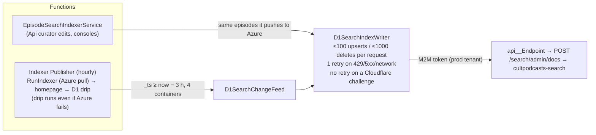

# Search sync, weekly reset, and read replication

## Today (Azure)

| Path | Mechanism | Fate |
|------|-----------|------|
| Hourly pull | Azure Search indexer ← Cosmos `_ts` watermark | **Retire** (Azure-only) |
| Push on mutation | `SearchIndexerService.MergeOrUpload` / `Delete` | **Keep** — retarget at D1 |

## Target: drip + weekly safety net

### Drip (in-week amends)

Existing push call-sites POST batches to an authenticated search Worker admin route:

```json
{ "upserts": [ /* CompactSearchRecord-shaped docs */ ], "deletes": [ "id", "…" ] }
```

Worker applies one `db.batch()`:

- `INSERT … ON CONFLICT DO UPDATE` / `DELETE`
- FTS external-content triggers keep the index in step
- `modified_at` guard ignores stale replays (reorder/retry safe)
- Upserted row visible to the next query — no downtime

Transport: shared-secret header (like today’s `api-key`) or Auth0 M2M. Prefer landing on
the api Worker then **service binding** to the search Worker (avoids Bot Fight Mode on
public hostnames). The Functions are production only, so they hold production secrets only.

Expected volume: tens of mutations/hour — far below any batching threshold.

### As built (SP-2.1, #1321)

Code: `Class-Libraries/RedditPodcastPoster.EntitySearchIndexer/D1Search/`. Azure is untouched; D1 is written
**next to** it, never instead of it.



| Path | What | Why |
|------|------|-----|
| **Drip** (`D1SearchChangeFeed`, Publisher) | Every episode, TV episode, news report and film whose Cosmos `_ts` is in the last `d1Search:DripLookbackMinutes` (180): eligible → upsert, excluded → delete | The Azure **pull** indexers (and the FilmSearchPusher) are how most documents reach Azure; the Indexer function's new episodes never pass a push site. Stateless (no watermark, no LookUps write); the overlap is a free retry thanks to `modifiedAt`. |
| **Push mirror** (`EpisodeSearchIndexerService`) | The same episodes the Api/console push sends to Azure, upsert or delete, whatever Azure answered | Curator edits and removals show up in D1 at once, as in Azure. |
| **Not covered** | Cosmos **hard deletes** (no `_ts` left) | SP-2.2 reconcile (#1322) removes orphans. |

- **Same corpus as Azure:** documents come from the Azure push builders (`ToEpisodeSearchRecord`,
  `CataloguePlayableSearchDocument.For`), so image/service/identity rules are shared. Only the full
  description, `guests` and `modifiedAt` (= `_ts` × 1000) are added (SP-0.3). Eligibility
  (`D1SearchEligibility`) is Azure's: removed episode or podcast, denormalised `parentRemoved`, removed film.
- **Never breaks Azure:** the writer catches every D1, network and Auth0 failure, logs it at Error with the
  status and the Worker's message, and returns it. The Publisher guards the drip again. Azure results are
  returned unchanged.
- **One index:** the Functions write the **production** D1 index only (there are no preview Functions; Jon,
  17 Nov 2026). Settings `d1Search:Enabled`, `Endpoint`, `Auth0Domain`, `Audience`, `ClientId`, `ClientSecret`.
- **Switch:** `d1Search:Enabled` (bicep `d1SearchProductionEnabled`, **false** until Jon's OK). Enabled without
  endpoint or credentials is skipped with one warning. Console apps have no `d1Search` settings, so they never
  write D1.
- **Tokens:** one Auth0 client_credentials token, cached until five minutes before expiry (Auth0
  meters M2M tokens); a 401 drops it.

### Weekly reconcile

Indexer timer: Cosmos id inventory ↔ D1 ids → upsert missing/stale, delete orphans.
Define a **drift threshold**: small → patch; large / failed migration / tokenizer change
→ full rebuild (below).

### Weekly reset / blue-green (“drip failed, rebuild”)

**Preferred: in-place shadow rebuild**

1. Bulk-load Cosmos → `search_docs_new` + shadow FTS + triggers (live tables keep serving).
2. Verify (doc count + sample family counts).
3. Swap with `ALTER TABLE … RENAME` inside **one** `db.batch()` (transactional — readers
   see wholly old or wholly new).
4. Drop old tables.

Full-corpus load measured ~10 s on the demo DB; end-to-end including Cosmos export is
minutes.

**Alternative: dual database** (`SEARCH_DB_A` / `SEARCH_DB_B` + KV active pointer). Instant
rollback; KV ~60 s propagation is fine because both sides are valid mid-flip. Adopt only
if rebuild-while-serving interferes with live reads.

Orchestration: cron Worker or Cloudflare Workflows for export → load → verify → swap.

Gate the swap on verification so a bad build never goes live.

## Durable Objects?

**No — start without one** (epic §5A).

| Need | Why not a DO |
|------|----------------|
| Multi-writer race | D1 serializes writes on the primary |
| Ordering / retries | Idempotent upserts + `modified_at` |
| Burst during reconcile | Prefer **Cloudflare Queues** + `db.batch()` consumer |
| Weekly swap pointer | Rename batch is already atomic; KV pointer eventual consistency is fine |

A DO would put a single-object hop on a read-heavy path for fencing guarantees search
does not need (seconds of staleness are acceptable).

## Read replication (global)

Demo DB (2026-11-08): `running_in_region: WEUR`, `read_replication.mode: disabled`,
`jurisdiction: null`.

Enable `read_replication.mode: auto`:

- Cloudflare places a **read replica in every supported region**: ENAM, WNAM, WEUR, EEUR,
  APAC, OC (including the primary’s region).
- **No extra storage/compute charge** — same `rows_read` / `rows_written` billing.
- Writes always hit the **primary** (keep WEUR near Azure Functions / Cosmos).
- Reads must use the **Sessions API** (`env.DB.withSession(...)`); without it replicas
  exist but every query still hits the primary.
- Replica lag is async; session bookmarks give sequential consistency.
- If a jurisdiction were set, replicas would be pinned inside it — we have none.

Serves the browse path (~93.7% of traffic) from nearby replicas. Drip writes and rename
swaps propagate automatically.

## Autosuggest (unaffected)

`SearchSuggestionsIndexBuilder` → `PublishR2` → R2 → Api `searchSuggestions` (edge-cached)
never touches Azure Search. Post-cutover enrichment from D1 vocabulary is SP-5.3, not a
blocker for swap.
