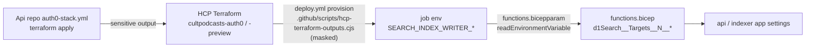

# Search sync, weekly reset, and read replication

## Today (Azure)

| Path | Mechanism | Fate |
|------|-----------|------|
| Hourly pull | Azure Search indexer ← Cosmos `_ts` watermark | **Retire** (Azure-only) |
| Push on mutation | `SearchIndexerService.MergeOrUpload` / `Delete` | **Keep** — retarget at D1 |

## Target: drip + weekly safety net

### Drip (in-week amends)

Existing push call-sites POST batches to an authenticated search Worker admin route:

```json
{ "upserts": [ /* CompactSearchRecord-shaped docs */ ], "deletes": [ "id", "…" ] }
```

Worker applies one `db.batch()`:

- `INSERT … ON CONFLICT DO UPDATE` / `DELETE`
- FTS external-content triggers keep the index in step
- `modified_at` guard ignores stale replays (reorder/retry safe)
- Upserted row visible to the next query — no downtime

Transport: shared-secret header (like today’s `api-key`) or Auth0 M2M. Prefer landing on
the api Worker then **service binding** to the search Worker (avoids Bot Fight Mode on
public hostnames). Plan preview + production secrets together.

Expected volume: tens of mutations/hour — far below any batching threshold.

### Writer credentials (SP-2.5, #1460)

The Functions call the api Worker's `POST /search/admin/docs` with an Auth0 **M2M** token for the
dedicated `search-index-writer` app (Api#284/#285, Terraform in the Api repo, one app per tenant). Its
client secret exists only as a sensitive output in HCP Terraform state. Nobody copies it:



| Target | Endpoint | Auth0 tenant | HCP workspace | Switch (`functions.bicepparam`) |
|--------|----------|--------------|---------------|-------------------------------|
| `production` | `api__Endpoint` (Key Vault `Api-Endpoint`, the Bot Fight bypass host) | prod (`auth.cultpodcasts.com`) | `cultpodcasts-auth0` | `d1SearchProductionEnabled` |
| `preview` | `https://api-preview.cultpodcasts.com/` | staging (`auth-staging.cultpodcasts.com`) | `cultpodcasts-auth0-preview` | `d1SearchPreviewEnabled` |

- **One-time setup (Jon):** RPP repo secret `TF_TOKEN_APP_TERRAFORM_IO`, an HCP Terraform API token
  that can read state outputs of both Auth0 workspaces (org `cultpodcasts`). The free plan has no
  teams, so this is a user token, like the Api repo's secret of the same name.
- **No token:** provision warns, exports nothing, and the targets get empty credentials; the sync
  skips them and logs it. Azure indexing is unaffected.
- **Token that cannot read the outputs**, or a workspace without them: provision fails, so a
  half-configured deploy never ships.
- **Rotation / rebuilt client:** re-run *Provision and Deploy* with `run_provision` after the Auth0
  apply. App settings only change when provision runs.
- Azure stays on bicep and Auth0 on Terraform; neither wraps the other. Key Vault is not used for
  this secret, so the Api repo needs no Azure login.

### Weekly reconcile

Indexer timer: Cosmos id inventory ↔ D1 ids → upsert missing/stale, delete orphans.
Define a **drift threshold**: small → patch; large / failed migration / tokenizer change
→ full rebuild (below).

### Weekly reset / blue-green (“drip failed, rebuild”)

**Preferred: in-place shadow rebuild**

1. Bulk-load Cosmos → `search_docs_new` + shadow FTS + triggers (live tables keep serving).
2. Verify (doc count + sample family counts).
3. Swap with `ALTER TABLE … RENAME` inside **one** `db.batch()` (transactional — readers
   see wholly old or wholly new).
4. Drop old tables.

Full-corpus load measured ~10 s on the demo DB; end-to-end including Cosmos export is
minutes.

**Alternative: dual database** (`SEARCH_DB_A` / `SEARCH_DB_B` + KV active pointer). Instant
rollback; KV ~60 s propagation is fine because both sides are valid mid-flip. Adopt only
if rebuild-while-serving interferes with live reads.

Orchestration: cron Worker or Cloudflare Workflows for export → load → verify → swap.

Gate the swap on verification so a bad build never goes live.

## Durable Objects?

**No — start without one** (epic §5A).

| Need | Why not a DO |
|------|----------------|
| Multi-writer race | D1 serializes writes on the primary |
| Ordering / retries | Idempotent upserts + `modified_at` |
| Burst during reconcile | Prefer **Cloudflare Queues** + `db.batch()` consumer |
| Weekly swap pointer | Rename batch is already atomic; KV pointer eventual consistency is fine |

A DO would put a single-object hop on a read-heavy path for fencing guarantees search
does not need (seconds of staleness are acceptable).

## Read replication (global)

Demo DB (2026-11-08): `running_in_region: WEUR`, `read_replication.mode: disabled`,
`jurisdiction: null`.

Enable `read_replication.mode: auto`:

- Cloudflare places a **read replica in every supported region**: ENAM, WNAM, WEUR, EEUR,
  APAC, OC (including the primary’s region).
- **No extra storage/compute charge** — same `rows_read` / `rows_written` billing.
- Writes always hit the **primary** (keep WEUR near Azure Functions / Cosmos).
- Reads must use the **Sessions API** (`env.DB.withSession(...)`); without it replicas
  exist but every query still hits the primary.
- Replica lag is async; session bookmarks give sequential consistency.
- If a jurisdiction were set, replicas would be pinned inside it — we have none.

Serves the browse path (~93.7% of traffic) from nearby replicas. Drip writes and rename
swaps propagate automatically.

## Autosuggest (unaffected)

`SearchSuggestionsIndexBuilder` → `PublishR2` → R2 → Api `searchSuggestions` (edge-cached)
never touches Azure Search. Post-cutover enrichment from D1 vocabulary is SP-5.3, not a
blocker for swap.
