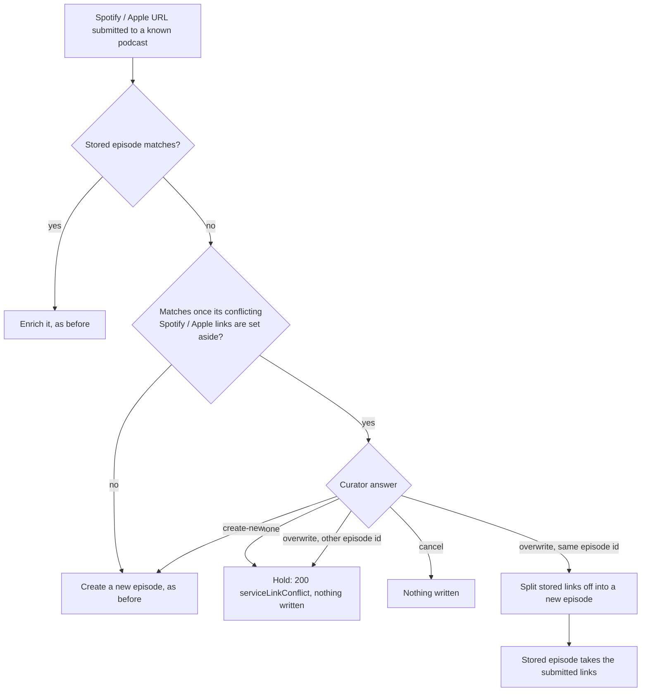

# Submit URL: service-link conflict (#1416)

A curator submits a Spotify or Apple Podcasts URL. It resolves to an episode of a podcast we already hold, and one
stored episode matches it by the normal submit rules (title, release and duration), **except** that the stored
episode already carries a different Spotify (or Apple) id. Before #1416 the submit refused to match it and quietly
created a duplicate episode. Now the curator chooses.

## Choices

| Answer (`serviceLinkConflictDecision`) | Result |
| --- | --- |
| *(absent: first submit)* | Nothing is written. 200 with `serviceLinkConflict` (the stored episode and each stored / submitted link). |
| `overwrite` + `serviceLinkConflictEpisodeId` | The stored episode's conflicting links are **split off into a new episode** of the same podcast, then the stored episode takes the submitted links. Both episodes are saved (split-off first) and indexed. |
| `create-new` | The URL is filed as a new episode, as before #1416. |
| `cancel` | Nothing is written. 200 with `cancelled: true`. |

An `overwrite` answer that names a different episode from the one now in conflict is asked again, so a stale answer
never overwrites another episode.

Callers with no curator prompt (the SubmitUrl console, discovery) keep the pre-#1416 behaviour: `SubmitOptions`
defaults to `ServiceLinkConflictChoice.CreateNew`. Only the Submit URL API (`SubmitUrlService`) asks, and only a
caller with the `curate` scope: `PostSubmitUrlHandler` sets `SubmitUrlRequest.CanResolveServiceLinkConflict` from
the token, never from the body. A `submit`-scope caller is never prompted, and any decision it sends is ignored
(it creates a new episode, as before #1416).

## Split-off episode

`EpisodeServiceLinks.SplitOff` (`RedditPodcastPoster.Episodes/Curation`) creates the new episode:

- same podcast, and a copy of the stored episode's title, description, release, length, language, subjects and
  parent fields, for the curator to correct;
- the moved links (url, image and nested id) and no others;
- marked as already posted to Reddit, X and Bluesky. It is a recovery record and is never posted automatically, and
  it does not share the stored episode's post ids.

## Shared curator operation

`EpisodeServiceLinks.Move(source, target, serviceKeys)` moves links between two episodes and never overwrites a
different link already on the target (that key is reported as conflicting and left on both). The split above uses
it, and the planned curator merge of duplicate episodes (#1471) is meant to reuse it.

## Code

| Piece | Where |
| --- | --- |
| Conflict detection | `EpisodeHelper.ConflictingServiceKeys` |
| Curator choice | `ServiceLinkConflictGate`, called by `CategorisedItemProcessor` before enrich / create |
| Wire | `SubmitUrlRequest.serviceLinkConflictDecision` / `serviceLinkConflictEpisodeId`; `SubmitUrlResponse.serviceLinkConflict` |
| Site | `send-podcast` asks overwrite / create new / cancel (website companion PR) |
