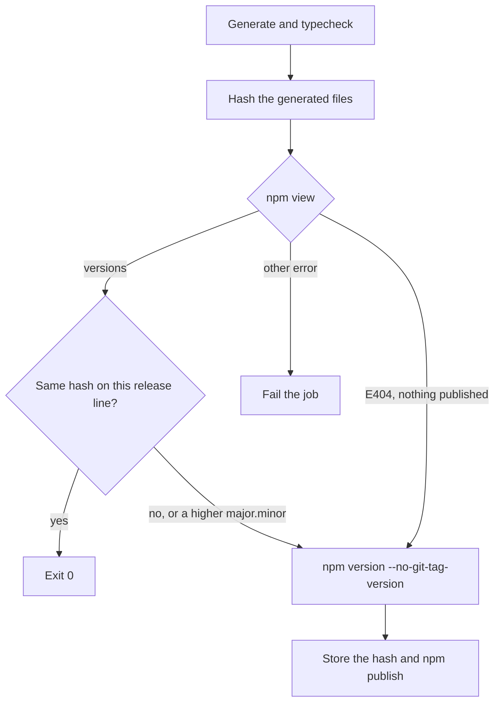

# TypeScript contracts (`@cultpodcasts/contracts`) <!-- pragma: allowlist secret -->

The Azure Functions HTTP DTOs are the source of truth. `Tools/ContractExporter` reads them during the build and writes TypeScript types, Zod schemas and a JSON Schema bundle to `contracts/`. Those generated files are gitignored. That folder is the private npm package `@cultpodcasts/contracts`, published to GitHub Packages (`npm.pkg.github.com`). `cultpodcasts` is a personal GitHub user, so the scope is that user — there is no organisation registry. <!-- pragma: allowlist secret -->

The Api worker (`src/openapiSchemas.ts`) and the website (`*.interface.ts`) still keep their hand-written copies. This package is the replacement; those repos are not switched over here.

## What is generated

A type is a root when it has `[ExportContract]` (`Cloud/Api/Contracts/ExportContractAttribute.cs`). The generator then follows referenced types in `Api.Dtos` only. A property whose type is a class, record, struct, or enum outside `Api.Dtos` fails the build and names that property. Primitives and BCL types such as `string`, `Guid`, `DateTime`, `TimeSpan`, `Uri`, and collections are fine. To export every public type in `Api.Dtos`, add an assembly attribute:

```csharp
[assembly: ExportContractNamespace("Api.Dtos")]
```

That exports every public concrete class, struct and enum in that exact namespace (not child namespaces).

The roots are `SearchIndexerState`, `EpisodeUpdateResponse`, `EpisodeDto` and `PublicEpisodeDto`. `PublicEpisodeDto` is the public `/public/episode/{id}` body the website bookmarks page reads (#1502). It carries the optional `imageRemoved` flag (#1500), which the curator `EpisodeDto` does not; its `ids` and `services` use the JSON-identical `EpisodeIdsDto` and `ServiceLinkDto`, so the public wire bytes are unchanged. Their closure (ids, urls, images, subjects, people, service links, `ServiceDto`, `ApprovalStatusDto`, and the nested guest-match types) is included with them. <!-- pragma: allowlist secret -->

## Why a build target, not Tapper or TypeGen

The package has to match the bytes the isolated worker writes. Those bytes come from the options object on `WorkerOptions.Serializer`. `ApiJson.CreateHttpSerializerOptions()` builds that serializer the way the function app does: `FunctionsApplication.CreateBuilder` calls `ConfigureFunctionsWorkerDefaults` (case-insensitive property names, `DefaultIgnoreCondition` left at `Never`) and `AddUtcJsonDateTimes()` adds `UtcDateTimeConverter` / `UtcDateTimeOffsetConverter`. `WorkerOptionsSetup` assigns `WorkerOptions.Serializer` from `IOptions<JsonSerializerOptions>`.

Tapper and TypeGen do not see those options. `JsonSchemaExporter` was the closest built-in, but a custom `JsonConverter<DateTime>` makes it emit an unconstrained schema for every instant, so the trailing `Z` would still be a hand-written exception. The exporter therefore walks the same options the host uses:

| C# | JSON |
|----|------|
| `[JsonPropertyName]` | that name; otherwise the worker naming policy |
| `[JsonPropertyOrder]` | property order (reflection order when the order ties) |
| `[JsonIgnore(WhenWritingNull)]` or `[JsonIgnore(WhenWritingDefault)]` | key omitted. `WhenWritingNull` is TypeScript optional and nullable (`T \| null`) and Zod `.nullable().optional()`. `WhenWritingDefault` is optional, and nullable only when the CLR type is nullable |
| nullable property without that attribute | key present, value `null`. TypeScript `T \| null` (required). Zod `.nullable()` with no `.optional()` |
| `[JsonConverter(typeof(JsonStringEnumConverter))]` on the property or the enum, a global string-enum converter, or `ItemConverterDecorator<JsonStringEnumConverter>` on a collection that factory can convert | member name. If every exported use of an enum agrees, the named type uses that form. A plain `JsonStringEnumConverter` on a collection does not change element JSON |
| `DateTime` / `DateTimeOffset` through the UTC converters | ISO-8601 ending in `Z` (up to 7 fractional digits) |
| `LocalOffsetDateTimeOffsetConverter` | numeric offset, never `Z` (discovery `slotStartUk`) | <!-- pragma: allowlist secret -->
| `TimeSpan` | constant format, e.g. `01:30:00` or `1.00:00:00` |
| `Guid` | string, `uuid` |
| `Uri` | string, `uri` |
| `long` / `int` | JSON number (`z.number().int()`, TypeScript `number`). `EpisodeDto.AppleId` and `EpisodeIdsDto.Apple` (`long?`) stay JSON numbers and are assumed within `Number.MAX_SAFE_INTEGER` (9007199254740991). |

`contentKind` stays a string. The C# property is `string?`, not an enum, so the contract does not invent `Episode | NewsReport | TvShowEpisode | Film`.

## Build

`Tools/ContractExporter` is in the solution. Target `ExportTypescriptContracts` runs after that project's build and `dotnet exec`s the built dll, writing `contracts/src`, `contracts/schemas` and `contracts/typecheck`. Those three directories are gitignored (`contracts/.gitignore`). The target's input is the built dll and its outputs are the four generated files, which are also `UpToDateCheckOutput`. An up-to-date dll skips `dotnet exec`. Deleting a generated file makes the project out of date, so the next build writes it again. A local `dotnet build` refreshes them and does not dirty git. Writes are skipped when the bytes already match. Design-time and `dotnet watch` builds skip the target.

The hand-written package shell stays in git: `package.json`, `package-lock.json`, `tsconfig.json`, `.npmrc`, `README.md`, and `.gitignore`. The generator does not overwrite those.

CI builds the solution (which runs the generator), typechecks the generated package (`npm run typecheck` under `contracts/`), and runs the contract tests. There is no committed copy to drift against.

## Version and publish

Git stores the release line in `contracts/package.json` as `major.minor.0`. The patch in git is always `0`. Change the major for a breaking wire change, or the minor for an intentional compatible line. Do not hand-edit the patch. `scripts/assert-contract-package-version.ps1` rejects any other shape. It does not diff a base ref.

The published patch is assigned on `main` by `.github/workflows/publish-contracts.yml`. The workflow builds `Tools/ContractExporter`, typechecks, then runs `scripts/publish-contracts-package.ps1`. That script hashes `src/index.ts`, `src/zod.ts` and `schemas/contracts.schema.json` (newline-normalised). It reads published versions with `npm view`. When nothing is published, the first version is `major.minor.0`. When the hash matches the highest published version on this same line, the job exits 0. When the hash differs, or the published package has no `contractsContentHash`, the script runs `npm version <version> --no-git-tag-version --allow-same-version` (the flag is required when that version is already `major.minor.0` in git), writes the hash onto that package, and publishes. A move to a higher major or minor publishes `major.minor.0` of the new line. A committed line behind the registry fails the job. An `npm view` error other than package-not-found (`E404`) fails the job. The workflow does not commit the version back to git.

`github.run_number` is not the patch. It does not reset when the release line changes, and a skipped publish would still burn a number. The registry is the source of the next patch. A concurrency group (`cancel-in-progress: false`) stops two main publishes from reading the same highest patch. A retry sees the hash it just published and exits 0.



The workflow runs for pushes to `main` that touch `contracts/**`, `Tools/ContractExporter/**`, `scripts/publish-contracts-package.ps1`, `Cloud/Api/Dtos/**`, `Cloud/Api/Contracts/**`, `Cloud/Api/Serialization/**`, the UTC JSON registration, or the model JSON converters, and for a manual run from `main`. A domain type still has to be mapped to an `Api.Dtos` boundary DTO before it can change the generated files. Paths are wider than that on purpose: a run whose generated hash matches the registry publishes nothing. It uses `GITHUB_TOKEN` with `packages: write` and does not run for any other branch. This pull request does not publish.

GitHub Packages previously blocked a streaming-submit contract publish (Api `docs/contract-publish.md`). The workflow is in place; a publish still needs Packages to accept the package from this user account.

## Installing

`contracts/.npmrc` points the scope at GitHub Packages. Consumers need the same registry and a token. Do not commit the token.

```ini
@cultpodcasts:registry=https://npm.pkg.github.com <!-- pragma: allowlist secret -->
//npm.pkg.github.com/:_authToken=${NODE_AUTH_TOKEN}
```

```bash
npm install @cultpodcasts/contracts <!-- pragma: allowlist secret -->
```

```ts
import type { EpisodeDto, EpisodeUpdateResponse, SearchIndexerState } from "@cultpodcasts/contracts"; <!-- pragma: allowlist secret -->
import { episodeDtoSchema, episodeUpdateResponseSchema } from "@cultpodcasts/contracts/zod"; <!-- pragma: allowlist secret -->
```

Zod is a peer dependency (`^4.0.0`). The package ships TypeScript source. CI typechecks it against the Zod 4 dev dependency. The Api worker and the website do not depend on Zod yet.

### Token

| Consumer | Credential |
|----------|------------|
| This repo's Actions (typecheck) | none — it uses the committed sources, not the registry |
| This repo's publish workflow | `GITHUB_TOKEN` with `packages: write` |
| Api or website GitHub Actions | a PAT. Another repository's `GITHUB_TOKEN` cannot read a package published from this repo. Classic `read:packages`, or a fine-grained token that can read this package. Store it as `NODE_AUTH_TOKEN`. |
| Cloudflare Workers Builds | the same PAT as a build environment variable named `NODE_AUTH_TOKEN` (a build secret, not a Worker runtime secret). The project's `.npmrc` must contain the two lines above so `npm ci` can fetch the scope. |

The package is private because it is published from this repository. A token without `read:packages` gets a 401/403 from `npm.pkg.github.com`, not a missing-version error.
